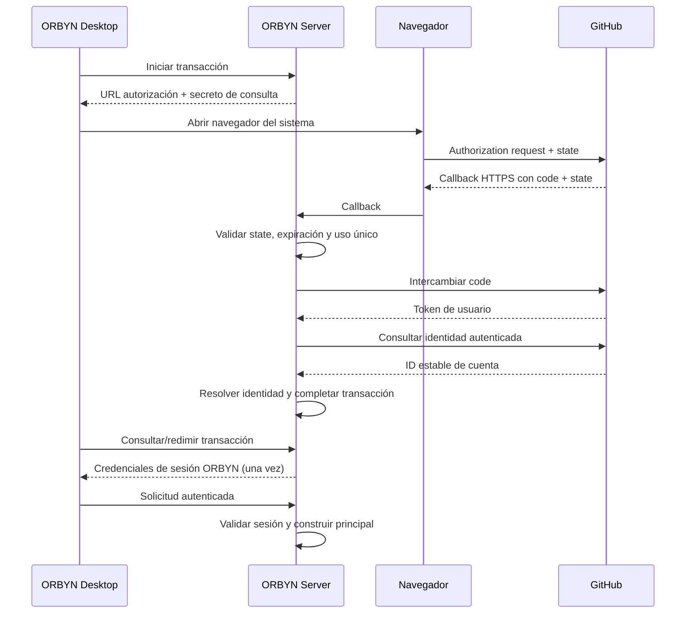

# ADR 0002: autenticación GitHub y sesiones de ORBYN

- Estado: Propuesto
- Fecha: 2026-11-28
- Issue: #40

## Contexto

ORBYN dispone de un cliente desktop nativo y un plano de control HTTP. La identidad interna se representa mediante `UserId`; `orbyn-identity` modela el principal autenticado y la identidad externa GitHub. Desktop es un cliente público: cualquier secreto incluido en su binario puede extraerse. El client secret y las claves privadas de GitHub App nunca pueden distribuirse con el cliente.

La autenticación debe abrir el navegador del sistema, volver al cliente sin un callback local expuesto y emitir una sesión ORBYN que el servidor pueda expirar y revocar.

## Decisiones

### 1. Proveedor y límites

- Se utilizará una **GitHub App** como integración principal, no PATs ni credenciales personales.
- La autorización de usuario demuestra el control de la cuenta GitHub. El servidor obtiene el identificador numérico estable mediante una consulta autenticada a la API.
- La identidad se resuelve por `(provider, external_account_id)`. Login, correo y nombre visible son metadatos mutables.
- La autenticación no concede por sí misma acceso a repositorios ni permisos dentro de ORBYN.
- El acceso a repositorios será una autorización separada, preferentemente mediante instalación de GitHub App con permisos granulares mínimos. Los tokens de GitHub no son sesiones ORBYN.

### 2. Desktop: Authorization Code con callback HTTPS del servidor

Se adopta Authorization Code con callback HTTPS en el plano de control. Desktop inicia la operación y abre el navegador del sistema; el servidor es el cliente OAuth confidencial y único receptor del callback.

1. Desktop solicita iniciar una transacción de autenticación.
2. El servidor genera valores criptográficamente aleatorios e independientes para `state` OAuth, identificador de transacción y secreto de consulta/redención del cliente. Persiste hashes de secretos, vencimiento y estado de un solo uso.
3. El servidor conserva el contexto OAuth y el verificador PKCE cuando el flujo de GitHub App lo soporte. Devuelve a Desktop la URL de autorización y el secreto opaco de consulta. Este secreto nunca se incluye en la URL del navegador.
4. Desktop abre la URL mediante el navegador del sistema. No incrusta un navegador ni solicita credenciales GitHub.
5. GitHub redirige exclusivamente al callback HTTPS registrado. El servidor valida `state` contra la transacción, su expiración y su estado no consumido.
6. El servidor intercambia el código directamente con GitHub. El client secret permanece en el servidor. El código es de un solo uso y nunca se registra.
7. El servidor consulta la API autenticada de GitHub para obtener el ID estable. No confía en IDs, usernames ni perfiles enviados por el cliente o parámetros del callback.
8. El servidor resuelve la identidad externa mediante el caso de uso de aplicación. Una identidad vinculada a otra cuenta interna produce conflicto; nunca se reasigna automáticamente.
9. El callback marca la transacción como completada y devuelve al navegador una página mínima sin tokens ni datos privados.
10. Desktop consulta el estado con su secreto independiente. Una redención atómica de un solo uso entrega las credenciales de sesión ORBYN. Las consultas repetidas no vuelven a entregar credenciales.
11. El servidor invalida la transacción y elimina código OAuth, verificador PKCE y datos temporales. Si vence, debe iniciarse otra.

El callback del servidor evita depender de un puerto loopback o esquema URI personalizado. El secreto de consulta separado de `state` impide que el navegador o la URL de autorización puedan redimir por sí solos la sesión del cliente.

**Device Authorization Grant no será el flujo predeterminado para Desktop.** GitHub recomienda Authorization Code con PKCE frente a Device Flow cuando se puede usar navegador y advierte que Device Flow carece de redirect URI y puede facilitar suplantación en escenarios de phishing. Podrá reconsiderarse para CLI o dispositivos realmente headless, con evaluación de amenazas específica.

### 3. Sesiones ORBYN

- Una autenticación GitHub exitosa crea una sesión propia. El token GitHub nunca es bearer token de las APIs ORBYN.
- Las credenciales de sesión serán opacas, aleatorias y de alta entropía. No se usarán JWT autocontenidos como autoridad primaria: la revocación inmediata requiere estado en servidor.
- El servidor conserva ID de sesión, `UserId`, hashes de credenciales, creación/expiración, actividad relevante, revocación y familia de renovación. Nunca persiste el secreto en claro.
- Se separan credencial de acceso de vida corta y credencial de renovación de vida mayor. La renovación rota la credencial atómicamente; reutilizar una credencial anterior revoca la familia afectada.
- Los límites de inactividad y duración absoluta serán política configurable del servidor. La renovación no extenderá indefinidamente la duración absoluta.
- Cerrar sesión revoca la sesión y elimina credenciales locales. Se prevé revocación por sesión y revocación global de cuenta.
- Desktop guarda credenciales exclusivamente en el almacén seguro del sistema operativo (por ejemplo, Secret Service/libsecret en Ubuntu). Nunca en preferencias, logs, argumentos de proceso ni archivos locales sin cifrar.
- Toda comunicación usa HTTPS. Los endpoints no exponen secretos en query strings, URLs, errores ni telemetría.

### 4. Principal y autorización

- El servidor valida la sesión y construye `AuthenticatedPrincipal` desde el `UserId` asociado.
- Los casos de uso reciben el principal desde contexto confiable del servidor; no aceptan un `UserId` del cliente como autenticación.
- Identidad GitHub (control de cuenta externa), principal ORBYN (usuario interno) y autorización (acciones permitidas en organización/equipo/proyecto/recurso) son conceptos separados.
- Los permisos de GitHub no se convierten automáticamente en roles ORBYN. Las políticas internas son autoridad del plano de control.

### 5. Secretos y tokens GitHub

- El client secret de GitHub App se inyecta únicamente al proceso servidor mediante configuración segura. Nunca se versiona ni distribuye en Desktop.
- El token GitHub usado para verificar identidad permanece en memoria el tiempo mínimo y se descarta al resolver la cuenta, mientras no exista un caso de uso que requiera acceso API.
- Si una capacidad posterior necesita conservar credenciales, deberá definir una decisión específica: cifrado en reposo, claves fuera de la base, alcance mínimo, expiración, revocación y auditoría.
- No se registran códigos OAuth, `state`, verifiers PKCE, secretos de consulta, tokens GitHub ni credenciales ORBYN.

## Secuencia de alto nivel

## Persistencia y módulos

- No se agregan dependencias OAuth/HTTP/almacenamiento a `orbyn-domain` ni a `orbyn-identity`.
- `orbyn-identity` conserva tipos de identidad y principal, sin tokens ni transporte.
- `orbyn-application` conserva casos de uso y puertos mínimos propiedad de sus consumidores.
- Adaptadores GitHub/OAuth, transacciones de login y sesiones pertenecen a infraestructura del plano de control; el servidor los compone.
- Se respeta ADR 0001: PostgreSQL será autoridad compartida. Tablas e índices se diseñarán junto al primer caso de uso durable; no se crean en esta decisión.
- No se agrega Redis, servicio externo de sesiones ni proveedor comercial.

## Amenazas y mitigaciones

| Amenaza | Mitigación |
|---|---|
| CSRF/callback inyectado | `state` aleatorio, vinculado a transacción, expiración y uso único |
| Repetición de callback/código | Código de un solo uso y redención atómica |
| Robo del secreto de consulta | Secreto separado de `state`, nunca en URL, hash y expiración |
| Suplantación de identidad | Consultar API GitHub desde servidor; usar ID estable |
| Filtración del client secret | Solo servidor; configuración segura; nunca binario, Git o logs |
| Robo de sesión | Credenciales opacas, TLS, keyring del SO, hashes, expiración y revocación |
| Reutilización de refresh token | Rotación atómica y revocación de familia |
| Escalada de privilegios | Separar identidad/autorización y validar permisos en cada caso de uso |
| Phishing de Device Flow | No usarlo por defecto si existe navegador y callback HTTPS |
| Filtración por observabilidad | Redactar secretos y códigos; logs con IDs no secretos |

## Alternativas consideradas

- **Device Flow para Desktop:** descartado como predeterminado por carecer de redirect URI y aumentar riesgo de phishing. Reservado para CLI/headless con análisis específico.
- **Callback loopback/esquema URI:** no elegido inicialmente; añade dependencias de puertos locales, registro de esquemas y protección contra interceptación.
- **Token GitHub como sesión ORBYN:** rechazado; acopla autorización interna al proveedor y elimina control propio de sesiones.
- **JWT sin estado como única sesión:** rechazado porque revocación inmediata y detección de reutilización requieren estado servidor.
- **Guardar tokens en preferencias:** rechazado; se requiere almacén de credenciales del sistema operativo.

## Consecuencias

- El servidor requiere URL pública HTTPS y callback registrado en GitHub App.
- La configuración de GitHub App y secretos de despliegue son tareas operativas separadas; no se incluyen en commits ni se solicitan en issues.
- La implementación futura debe probar expiración, consumo único, concurrencia de redención, rotación/reutilización, conflicto de identidad y revocación.
- Este ADR no implementa OAuth, endpoints, sesiones, almacenamiento, migraciones ni llamadas de red.

## Referencias

- [GitHub: Best practices for creating a GitHub App](https://docs.github.com/en/apps/creating-github-apps/about-creating-github-apps/best-practices-for-creating-a-github-app)
- [GitHub: Generating a user access token for a GitHub App](https://docs.github.com/en/apps/creating-github-apps/authenticating-with-a-github-app/generating-a-user-access-token-for-a-github-app)
- [GitHub: Authorizing OAuth apps](https://docs.github.com/en/apps/oauth-apps/building-oauth-apps/authorizing-oauth-apps)
